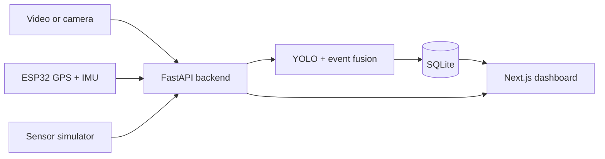

<div align="center">

# 🚦 RoadSense AI

### Multimodal traffic safety and road-event monitoring

Analyze road video alongside live GPS and motion data. RoadSense AI combines
computer vision with ESP32 sensor readings to surface driving events, monitor
sensor health, and review analysis sessions from a live dashboard.

**FastAPI · Next.js · YOLO · SQLite · ESP32**

</div>

---

## What it does

- **Video analysis** — detect and track road users in uploaded clips or camera streams.
- **Sensor monitoring** — receive GPS and IMU data from an ESP32, or use the simulator without hardware.
- **Trust-aware event fusion** — combine vision and sensor signals while accounting for stale or missing readings.
- **Live dashboard** — view system health, sensor status, sessions, alerts, and live analysis updates.
- **Session review** — inspect processed video, event frames, and recorded results.

> RoadSense AI is a research and demonstration project. It is not a certified
> driver-assistance system and should not be used as a substitute for safe driving.

## How the pieces fit together



| Component | Location | Role |
|---|---|---|
| Backend | `backend/` | FastAPI API, video pipeline, sensor fusion, and SQLite storage |
| Dashboard | `frontend/` | Next.js interface for live status, analysis, sessions, and alerts |
| Firmware | `firmware/` | PlatformIO ESP32 application for GPS and IMU sensor packets |

## Quick start (Windows)

### 1. Start the backend

Install **Python 3.10 or newer**. In PowerShell:

```powershell
cd backend
if (-not (Test-Path .env)) { Copy-Item .env.example .env }
```

Open `backend/.env` and set a private `API_KEY`. Keep this key in sync with the
firmware or simulator configuration. Put the YOLO weights expected by
`MODEL_PATH` in `backend/weights/` (the example configuration uses
`weights/best.pt`).

Run the setup script once, then start the API:

```powershell
.\setup.bat
.\run.bat
```

The backend listens on **http://localhost:8000**. Open
**http://localhost:8000/docs** for interactive API documentation.

### 2. Start the dashboard

In a second terminal:

```powershell
cd frontend
npm install
npm run dev
```

Open **http://localhost:3000**. The dashboard uses the backend at
`http://localhost:8000` by default.

## Try it without an ESP32

With the backend running, open a third terminal:

```powershell
cd backend
.\.venv\Scripts\activate
python scripts\simulate_sensor.py --mode mixed
```

The simulator reads `API_KEY` from `backend/.env` and sends sample sensor
packets once per second. Available modes:

| Mode | Demo |
|---|---|
| `normal` | Steady sensor readings |
| `brake` | Harsh-braking events |
| `turn` | Sharp-turn events |
| `mixed` | Braking and turning events |
| `dropout` | Temporary sensor-data gaps |

For example, run `python scripts\simulate_sensor.py --mode dropout` to see how
the system responds when sensor readings go stale.

## Connect an ESP32

1. Open `firmware/` in VS Code with the PlatformIO extension.
2. Copy `firmware/src/phone_gps_config.example.h` to
   `firmware/src/phone_gps_config.h`.
3. Set the Wi-Fi, GPS source, backend URL, and API key to your own values. Use
   your computer's local IP address for the backend URL (find it with `ipconfig`).
4. Connect the ESP32 and computer to the same **2.4 GHz** network, allow port
   `8000` through the Windows firewall if prompted, then build and upload with
   PlatformIO.
5. Hold the board still for about one second after startup so the IMU can
   calibrate.
6. Verify the sensor axes by braking the board by hand. If `peak_decel_g` stays
   near zero, adjust `FORWARD_AXIS`; if braking registers as acceleration,
   invert  `FORWARD_SIGN`.

The local `phone_gps_config.h` can contain credentials. Do not commit it or
share your API key or Wi-Fi password.

## Analyze video and inspect results

Use the dashboard or the backend API docs to start an analysis. The backend
accepts video uploads at `POST /api/analysis/upload`; a successful request
returns a `session_id`.

Useful endpoints:

| Endpoint | Purpose |
|---|---|
| `GET /api/health` | Backend health |
| `GET /api/hardware/status` | ESP32/simulator connection status |
| `GET /api/sensors/latest` | Most recent sensor reading |
| `GET /api/sessions` | List analysis sessions |
| `GET /api/sessions/{id}` | Session summary |
| `GET /api/sessions/{id}/frames` | Frames and detections for a session |
| `GET /api/alerts` | Recent alerts |
| `GET /api/stream/{id}` | Annotated video stream |
| `ws://localhost:8000/ws/live/{id}` | Live analysis updates |

## Tests

From `backend/`, install `pytest` if needed and run:

```powershell
python -m pip install pytest
python -m pytest tests
```

The backend tests cover sensor ingestion and hardware status, event fusion,
motion tracking, and geographic distance calculations.

## Configuration and tuning

- **Backend settings:** `backend/.env` — see `backend/.env.example` for available
  settings such as the database URL, API key, model path, CORS origins, and
  sensor freshness window.
- **Firmware settings:** `firmware/src/phone_gps_config.h` — local Wi-Fi,
  backend, and GPS configuration.
- **Detection and event behavior:** tune the tracker and event/fusion settings
  in `backend/app/` for your own data and hardware.

Keep credentials and private video out of version control. The supplied model
weights and analysis quality depend on your local setup and test data.
